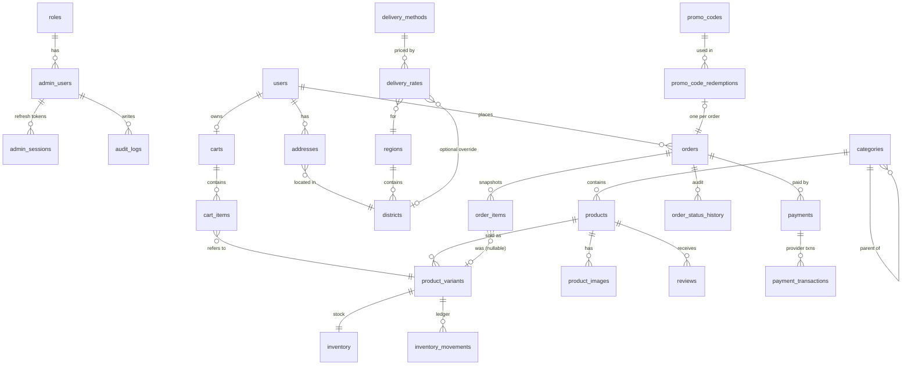

# Database

PostgreSQL 17 (16+ required: `NULLS NOT DISTINCT`). Schema is managed only by Alembic
migrations in `backend/app/database/migrations/versions/`:

| Revision | What |
|---|---|
| `95807fc3202d` initial schema | 28 tables, `pg_trgm` extension, `order_number_seq` |
| `7642bc13bed8` seed reference data | 14 regions, 206 districts/cities, 3 roles, store settings, 2 delivery methods (no prices) |
| `25aeb6aefb6f` order stock state | `orders.stock_state`: reserved / sold / released / returned |
| `a8fc36f3032a` fix admin email unique index | rebuilds the case-insensitive email index on `lower(email)` (the first version indexed a constant and allowed only one admin) |

## Entity relationships



`notifications` (outbound Telegram queue) and `store_settings` (key → JSON) stand alone.

## Integrity rules enforced by the database

Application code enforces business rules first; these constraints are the last line
of defence and are covered by `backend/tests/test_models.py`.

| Rule | Mechanism |
|---|---|
| Stock can never be oversold | `inventory`: CHECK `0 ≤ reserved ≤ on_hand`; reservations use `UPDATE … WHERE on_hand - reserved >= :qty` (tested with two concurrent transactions) |
| Discount price below price | CHECK on `product_variants` |
| One default variant / main image / default address | partial unique indexes |
| Order totals add up | CHECK `total = subtotal - discount_total + delivery_fee`; `line_total = unit_price * quantity` |
| No duplicate orders from double taps | UNIQUE `(user_id, idempotency_key)` on `orders` |
| An order is paid at most once | partial UNIQUE on `payments(order_id) WHERE status = 'paid'` |
| Duplicate payment callbacks are harmless | UNIQUE `(provider, external_id)` on `payment_transactions` |
| One region-wide rate per delivery method | UNIQUE `(method_id, region_id, district_id)` NULLS NOT DISTINCT |
| Promo code sanity | CHECKs: upper-case code, percent ≤ 100, positive limits, `used_count ≤ usage_limit` |
| History survives catalog edits/deletes | `order_items` copy name, SKU, attributes, prices; FKs to products are `SET NULL` |
| Categories with products cannot be deleted | FK `RESTRICT` |

## Conventions

- UUID primary keys; small integer keys for reference data (`regions`, `districts`, `roles`).
- All timestamps `timestamptz` in UTC; displayed in Asia/Tashkent.
- Money `NUMERIC(14,2)` in UZS.
- Status columns are `VARCHAR` + CHECK (not native enums) so adding a value is a plain `ALTER TABLE`.
- Every column with a default also has a database-side default, so SQL inserts outside the app behave the same.
- Constraint names are deterministic (`ck_<table>_<name>`, `uq_…`, `fk_…`, `ix_…`).
- Order numbers: `OS-001001`, `OS-001002`, … from `order_number_seq`.

## Reference data notes

Region and district names (Uzbek Latin, `ʻ` = U+02BB) are in
`backend/app/database/seed/uzbekistan_v1.py`. The list follows the publicly known
administrative division, but new tumans are created from time to time: verify it
against the official SOATO classifier, and correct entries from the admin panel or
with a new `uzbekistan_v2` data migration (never edit v1 in place).

## Working with migrations

```bash
cd backend
uv run alembic upgrade head                       # apply
uv run alembic revision --autogenerate -m "..."   # after changing models; review the file!
uv run alembic check                              # fails if models and migrations differ
uv run alembic downgrade -1                       # roll back one step
```

Autogenerate does not detect extensions, sequences or data changes; add those by hand.
